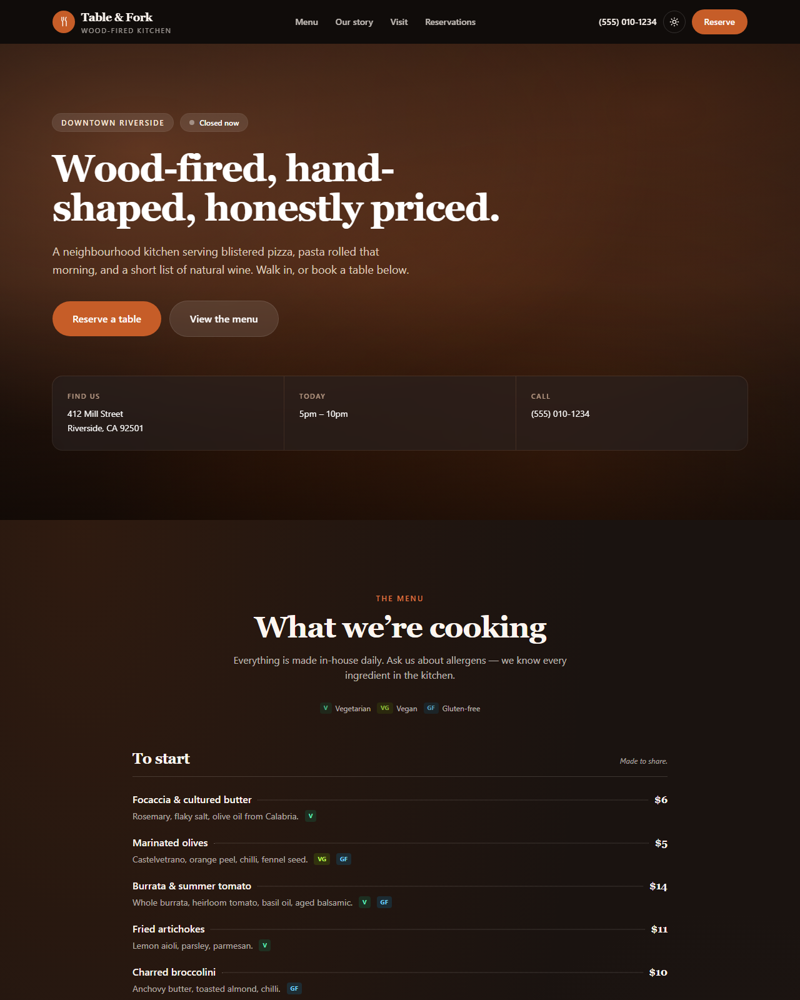

# 🍕 Table & Fork — Free Restaurant Website Template

**A production-ready restaurant website template built with Next.js 15, TypeScript, and Tailwind CSS v4.** Real HTML menus, reservations, opening hours, and local-SEO structured data. Clone it, edit one config file, deploy for free.

**[Live demo →](https://pixelandoak-tablefork.pages.dev)**
**[Template page →](https://pixelandoak.com/templates/restaurant-website-template/)**



## Why this template exists

Most restaurant websites fail in the same four ways. This template is built specifically to avoid them:

| The common mistake | What Table & Fork does |
| --- | --- |
| Menu as a **PDF** (or a photo of a printed menu) | Real, semantic HTML — Google can read it, phones can zoom it, screen readers can speak it |
| Hours and address buried on a *Contact* page | Address, today's hours, and phone sit in the hero |
| Autoplay video that delays the menu | **Zero image or video files.** Every visual is drawn in CSS |
| No structured data | `Restaurant` + `Menu` + `OpeningHoursSpecification` JSON-LD out of the box |

That first row matters more than anything else on this list. A PDF menu is invisible to search engines, which means you rank for none of the dishes you actually serve.

## Features

- 🍽️ **A real HTML menu** — sections, descriptions, prices, dietary badges, and dotted price leaders. Driven entirely by `config/site.ts`
- 🕐 **Live open/closed badge** — computed in the browser, so it is never stale (a static site that renders "Open now" at build time will be wrong within hours)
- 📅 **Reservation form** — party-size picker, past dates blocked, works with no backend out of the box; point it at OpenTable, Resy, SevenRooms, or Formspree with one line
- 🔍 **Local-SEO structured data** — `Restaurant`, `Menu`, `MenuSection`, `MenuItem`, and per-day opening hours, generated from your config automatically
- 🌙 **Real dark mode** — class strategy, localStorage persistence, OS-preference detection, and a no-flash inline script
- 🖼️ **Zero image dependencies** — hero, gallery, and textures are all CSS gradients. Nothing to license, nothing to optimise, nothing slow. Swap in real photography whenever you have it
- ⚙️ **One-file customization** — name, hours, address, menu, prices, and copy all live in `config/site.ts`
- 📦 **Fully static export** — `npm run build` emits plain HTML/CSS/JS to `/out`. Host it free on Cloudflare Pages, Netlify, Vercel, or GitHub Pages
- ♿ **Accessible** — semantic landmarks, labelled form controls, visible focus rings, `prefers-reduced-motion` respected
- 📱 **Responsive** — tested from 375px up, with a mobile nav panel and no horizontal scroll

## Quick start

```bash
git clone https://github.com/haider484991/tablefork-nextjs-restaurant-template.git my-restaurant
```

```bash
cd my-restaurant && npm install && npm run dev
```

Open [http://localhost:3000](http://localhost:3000).

## Make it yours

Everything lives in **`config/site.ts`**. Change these and the whole site follows — including the structured data:

```ts
export const siteConfig = {
  name: "Table & Fork",
  title: "Table & Fork — Wood-Fired Kitchen in Riverside",
  cuisine: "Italian",
  priceRange: "$$",

  contact: {
    phone: "(555) 010-1234",
    address: { street: "412 Mill Street", city: "Riverside", /* … */ },
  },

  hours: [
    { day: "Monday", closed: true, open: "", close: "" },
    { day: "Tuesday", closed: false, open: "17:00", close: "22:00" },
    // …
  ],

  menu: [
    {
      section: "Wood-fired pizza",
      note: "48-hour dough, 90 seconds at 450°C.",
      items: [
        {
          name: "Margherita",
          price: "15",
          description: "San Marzano, fior di latte, basil, olive oil.",
          tags: ["v", "popular"],
        },
      ],
    },
  ],
};
```

**Menu badges:** `v` (vegetarian), `vg` (vegan), `gf` (gluten-free), `popular`, `new`. Add your own in `TAG_STYLES` inside `components/sections/Menu.tsx`.

**Hours** use 24-hour `"HH:MM"` strings. Display formatting (`5pm – 10pm`) and the JSON-LD are both generated from them, so you only write them once. Closing times past midnight are handled correctly.

**Taking real bookings:** set `reservations.action` to your provider's endpoint. While it is `"#"`, the form shows a built-in demo confirmation instead of posting anywhere.

## Deploy

Build a static site:

```bash
npm run build
```

That emits `/out`. Deploy it anywhere — no Node server required:

```bash
npx wrangler pages deploy out
```

Netlify, Vercel, GitHub Pages, and any static host work the same way. Preview the production build locally with `npm run preview`.

## Tech

Next.js 15 (App Router, static export) · React 19 · TypeScript · Tailwind CSS v4 · zero runtime dependencies beyond React.

## License

MIT — free for personal and commercial use. Attribution appreciated but not required.

---

Built by [Pixel & Oak](https://pixelandoak.com/templates/restaurant-website-template/) — web design and AI development studio.
More free templates: [Nova (blog)](https://github.com/haider484991/nova-nextjs-blog-template) · [LaunchPad (SaaS)](https://github.com/haider484991/launchpad-nextjs-saas-template)
